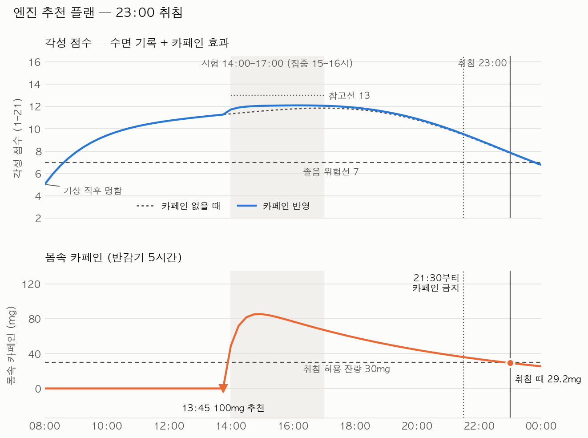
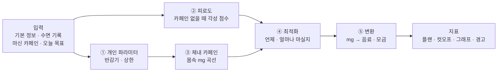

# ☕ 카페인 측정기 (Caffeine Project)

> 내 몸 상태와 오늘 일정을 넣으면 **언제 · 무엇을 · 얼마나** 마시고 **언제부터 끊을지** 알려주는 개인 맞춤 카페인 스케줄러

**▶ 웹에서 바로 써보기: https://kjyilj0707.github.io/caffeine_project/** (처음 열 때 10~20초 로딩)

깨어 있어야 할 때는 졸리고, 자야 할 때는 카페인 때문에 잠이 안 오는 문제를 풉니다.
감으로 마시는 대신, **수면 과학·약동학 논문의 숫자**로 계산합니다.



*엔진 추천 플랜 예시: 최근 6~7시간 수면, 14~17시 시험, 23:00 취침 → "13:45에 100mg, 21:30부터 금지".
위는 각성 점수(점선 = 카페인 없을 때), 아래는 몸속 카페인.*

---

## 어떻게 계산하나



| 단계 | 하는 일 | 근거 논문 | 상태 |
| --- | --- | --- | --- |
| ① 개인 파라미터 | 반감기(기본 5h), 하루·1회 상한, 흡연·피임약·임신 보정, 간질환·약물이면 상담 안내 | 식약처, EFSA 2015, Nehlig 2018 | ✅ `profile.py` |
| ② 피로도 | 수면 압력 + 생체 리듬 + 오후 처짐 + 기상 직후 멍함 → 각성 점수(14 또렷 · 7 위험선) | Åkerstedt 2004, Van Dongen 2003 | ✅ `fatigue.py` |
| ③ 체내 카페인 | 1구획 흡수·분해 모델, 여러 잔은 합산 | Gardiner 2023, Ramakrishnan 2016 | ✅ `pk.py` |
| 카페인 효과 | 졸림 × g (100mg → 졸림 약 19%↓, 3~4시간 지속) | Ramakrishnan 2016 (2B-Alert) | ✅ `effect.py` |
| ④ 최적화 | 졸림은 최대한 줄이고, 위험선 7 지키기 · 잠든 뒤 잔량 ≤ 30mg · 수면 감소 < 20분 · 상한 · 2시간 간격 | Vital-Lopez 2018, Gardiner 2023 | ✅ `optimizer.py` |
| ⑤ 변환 | 커피 0.43mg/ml 등 → 모금 수 (반대로 'n모금 마심' → mg) | Gardiner 2023 인용값 | ✅ `convert.py` |
| 지표 | 상한 대비 %, 위험선 위 시간 비율, 수면 부채, 일·주·월 리포트 | 식약처, NSF(7~9h) | ✅ `metrics.py` |
| 예측 vs 실제 | 각성 점수 → 예측 졸림(KSS)으로 바꿔 내가 남긴 졸림과 비교 · 잠들 때 몸속 카페인별 잠들기 시간 | Ingre 2014 (KSS = 10.6 − 0.6 × 각성 점수) | ✅ `calibration.py` (보여주기만) |

**핵심 숫자**
- 하루 상한 성인 400mg · 임산부 300mg · 청소년 2.5mg/kg (식약처), 1회 200mg (EFSA)
- 취침 때 몸속 카페인 **30mg 이하** — Gardiner 2023 컷오프(커피 107mg은 취침 8.8시간 전까지)를 역산
- 예상 수면 감소(분) = 21.02 − 0.05 × (취침 전 분) + 0.16 × (mg) — Gardiner 2023 메타회귀

모든 숫자는 [`parameters.yaml`](parameters.yaml)에 **출처**와 **확정/임시** 상태와 함께 있습니다. 코드에는 숫자를 직접 쓰지 않습니다.

## 결과 카드 예시

```text
☕ 오늘의 카페인 플랜

  13:45  커피 13모금 (228ml · 약 97mg)
  13:45 이후엔 플랜 외 카페인 금지
  ⛔ 21:30부터는 한 모금도 금지 (수면 보호)

오늘 총 100mg / 상한 400mg (25%)
잠든 뒤 몸속 카페인 최대 29.2mg (기준 30) · 예상 수면 감소 9.3분 (기준 20)
목표 구간 졸림 7% 감소
최근 1주 수면 부채 4.5시간
```

```python
from caffeine_engine.pipeline import run_day, format_card
from caffeine_engine.profile import Profile
result = run_day(Profile(age=24, weight_kg=70), sleeps, windows, bed_h=23.0, now_h=8.0)
print(format_card(result))
```

## 지금까지 알게 된 것

- 카페인의 **각성 효과는 3~4시간이면 사라지지만, 몸속 카페인은 반감기 5시간**으로 남는다 → 늦게 마신 커피는 수면만 방해하는 구간이 생긴다
- 카페인은 수면 부족으로 생긴 졸림을 **20~30% 정도만** 줄인다 → 수면을 대신할 수 없다
- 반감기 5시간이면 **하루 200mg만 돼도** 새벽 1시 취침을 지키기 빠듯하다
- 피로도 모델은 1주 이상 이어지는 수면 부족을 과소평가한다 (Van Dongen 2003과 비교) → 테스트로 기록
- 시험이 있으면 엔진은 **약 1시간 전**에 마시라고 한다 (효과 최고점이 마신 뒤 약 1시간)
- 23시 취침이면 하루 카페인 여유는 **약 100mg**뿐이다 — 수면 기준(잠든 뒤 30mg)이 가장 강한 제약
- 01시까지 깨어 있어야 하는데 밤에 졸리면, 카페인으로는 못 메운다 → 엔진이 '수면·휴식 필요'로 경고

## 폴더

| 경로 | 내용 |
| --- | --- |
| `parameters.yaml` | 엔진의 모든 숫자 + 출처 + 확정/임시 상태 |
| `beverages.yaml` | **음료 카페인 DB 129종** — 카페 9개 브랜드·편의점 커피·에너지음료·차 (출처·용량·mg, 조사일 2026-11-01) |
| `caffeine_engine/` | 계산 엔진 — `profile.py` ① · `fatigue.py` ② · `pk.py` ③ · `effect.py` 카페인 효과 · `optimizer.py` ④ · `convert.py` ⑤ · `metrics.py` 지표 · `pipeline.py` 전체 실행 + 결과 카드 · `scenario.py` 시나리오 파일 읽기 · `notify.py` 플랜 → 예약 알림 · `calibration.py` 예측 vs 실제 비교 |
| `tests/` | 논문 결과 재현 + 규칙 준수 + 화면 + 알림 + 음료 DB + 기록·리포트·개인화 검사 (133개) |
| `app/` | **화면** (Streamlit) — `streamlit_app.py` 시작(페이지 4개) · `page_plan.py` ☕ 추천 · `page_day.py` 📅 하루 입력 · `page_report.py` 📊 리포트 · `page_profile.py` 👤 프로필 · `state.py` 공유 입력 · `store.py` 서버 저장 · `report.py` 리포트 계산 · `account.py` 로그인 · `charts.py` 그래프 · `ntfy.py` 알림 |
| `supabase/` | 서버 표·권한(RLS) 정의 `migrations/` · 웹 푸시 발송 함수 `functions/send-push` |
| `index.html` | GitHub Pages용 — stlite로 브라우저 안에서 Python을 돌려 `app/`을 서버 없이 실행 |
| `scenarios/` | **데모 입력 파일** — 고쳐서 다시 실행하면 결과가 바뀜 |
| `scripts/` | `demo.py` 데모 · 확인용 그래프 스크립트 (`daychart.py` 공통 그리기) |
| `figures/` | 그래프 결과물 |
| `papers/` | 논문 목록 (PDF는 저작권 때문에 로컬 전용) |

## 실행

```bash
python3 -m venv .venv && .venv/bin/pip install -r requirements.txt   # 처음 한 번

.venv/bin/streamlit run app/streamlit_app.py             # 입력 화면 (브라우저가 열림)
.venv/bin/python scripts/demo.py                          # 데모: scenarios/ 시나리오 전부
.venv/bin/python scripts/demo.py scenarios/exam_day.yaml  # 시나리오 하나만
.venv/bin/python -m pytest -q                             # 테스트
```

### 데모 시나리오 바꾸기

`scenarios/exam_day.yaml`을 열어 숫자·시각을 고치고 다시 실행하면 결과 카드와 `figures/demo_*.png` 그래프가 바뀝니다.

```yaml
profile: {age: 24, weight_kg: 70, smoker: false, sensitivity: normal}
sleep:                  # 오래된 밤부터, 마지막 줄 = 어젯밤 ("잠든-깬")
  - "00:30-07:30"
  - "01:30-08:00"
today:
  now: "08:00"
  bed: "23:00"          # 기상 시각보다 이르면 다음 날 새벽
  already: []           # 예: - {time: "09:00", mg: 100} 또는 - {time: "09:00", sips: 8}
  windows:              # 깨어 있기 / 졸면 안 됨 / 집중
    - {kind: 졸면 안 됨, from: "14:00", to: "17:00"}
beverage: coffee        # coffee / black_tea / {name: "아메리카노 톨", mg: 150, ml: 355}
```

| 예시 시나리오 | 엔진의 답 |
| --- | --- |
| `exam_day` 시험 날, 23시 취침 | 13:45 커피 13모금, 21:30부터 금지 |
| `late_night` 과제 마감, 01시 취침, 오전에 이미 한 잔 | 18:15 7모금만 + "밤 1시간은 카페인으로 못 메움" 경고 |
| `smoker_early_shift` 흡연자, 05:30 기상 운전 출근 | 06:00 · 12:15 두 번 (분해가 빨라 375mg) |
| `pregnant_sensitive` 임신 후기, 카페인 민감 | 카페인 없이 (반감기 약 15시간이라 수면 기준을 지킬 수 없음) |

## 진행 상황

- [x] Step 0 — 논문 수집 (13건, 원문 확인)
- [x] Step 1-1 — 체내 카페인
- [x] Step 1-2 — 피로도
- [x] Step 1-3 — 카페인 효과
- [x] Step 1-4 — 최적화 (섭취 플랜 · 컷오프)
- [x] Step 1-5 — 개인 파라미터 · 모금 변환 · 지표 · 전체 실행기
- [x] Step 1-6 — 데모 (시나리오 파일 → 결과 카드 + 그래프)
- [x] Step 2 — 입력 화면 MVP (Streamlit, GitHub Pages 배포)
- [x] Step 3 — 알림 (☕ 마셔 / ⛔ 금지 / 상한 경고) — ntfy 예약 푸시, 핸드폰 수신 확인
- [x] 음료 카페인 DB 조사 (129종, `beverages.yaml`) — 브랜드→메뉴→사이즈 고르기로 앱에 연결 (4-④)
- [x] Step 4 — 로그인·기록 저장 (Supabase) · 화면 개편(페이지 4개) · 달력 · 앱 웹 푸시 알림 · 매일 피드백(졸림 KSS·잠들기) · 📊 리포트(하루·일주일·한 달)
- [x] Step 5-① — 예측 vs 실제: 리포트에 '모델 예측 졸림 vs 내 졸림', '잠들 때 카페인 vs 잠들기 시간' 표시 (추천은 아직 그대로)
- [x] UI 개편 (2026-11-04) — 휴대폰 화면 기준: 아래 탭 바 · 타이머형 추천(초록→노랑 10분 전→빨강 1분 전) · 카드형 리포트 · iOS 휠 입력(+직접 입력) · 다크/라이트 · 프로필/설정 목록형 + 설정 반영하기 · 아침 첫 화면 = 하루 입력(잘 시각 기준으로 날짜 넘김) · 피드백 화면
- [x] 나눠 마시기 추천 — '몇 모금' 대신 '잔 크기 · 마시는 시간 · 몇 분에 한 모금' (엔진: 한 잔을 마시는 시간 동안 10분마다 나눠 마신 것으로 계산, `parameters.yaml` pacing)
- [x] 브랜드별 컵 크기 9개 브랜드 + '그 외' (`beverages.yaml` cup_sizes, 조사일 2026-11-04)
- [x] 간편 로그인 — 이메일 + 비밀번호 (가입 때만 메일 확인, 비밀번호 없거나 잊으면 메일 코드로 들어와 비밀번호 설정)
- [ ] Step 5-② — 개인 보정: 쌓인 차이로 이 사람의 위험선·취침 허용 잔량 등을 조정해 추천에 반영

### Step 3 알림 — 방식 테스트 (2026-11-01, 핸드폰)

| 방법 | 결과 | 비고 |
| --- | --- | --- |
| 노션 캘린더 (구글 일정 + 리마인더 '이벤트 시작 시') | ❌ 3번 모두 안 옴 | 일정·리마인더는 정상 동기화, 핸드폰 알림만 안 뜸 |
| ntfy 즉시 푸시 | ✅ | 무료 앱 [ntfy](https://ntfy.sh) + 비밀 채널 구독 |
| **ntfy 예약 푸시 (3분 뒤)** | ✅ 앱을 닫아도 도착 | 웹앱이 '13:45에 보내기'를 예약 → 서버 없이 가능 (최대 3일 뒤) |

### 알림 쓰는 법

1. 핸드폰에 [ntfy](https://ntfy.sh) 앱 설치 → 알림 허용 → **＋** → 채널 이름 구독 (영문·숫자·-·_, 남이 못 맞힐 만큼 길게)
2. 웹 화면 맨 아래 「🔔 알림 예약」에 같은 채널 이름 입력 → **채널 끝 4자리**가 ntfy 앱과 같은지 확인
3. 「1분 뒤 테스트 알림」으로 확인 → 「오늘 알림 예약」 (☕ 마실 시각마다, ⛔ 절대 컷오프에 1개씩)
4. 입력하면 주소창 링크에 채널이 들어가니 그 주소를 즐겨찾기하면 다음부터 자동 입력

- 예약은 ntfy 서버가 보내므로 **브라우저를 닫아도** 알림이 온다 (최대 3일 뒤까지)
- 시각은 한국 시간(UTC+9) 기준. 이미 지난 알림은 표에 '건너뜀'으로 표시
- 한계: 플랜을 바꿔 다시 예약해도 이전 예약은 취소되지 않음 / 채널 이름을 아는 사람은 알림을 볼 수 있음
- 채널 이름은 저장소·파일 어디에도 저장하지 않는다

## 주의

이 프로젝트는 **의학적 조언이 아닙니다.** 평균적인 건강한 성인 기준의 예측이라 개인차가 큽니다.
임신 중이거나 간질환·심장질환이 있거나 카페인 분해를 늦추는 약을 먹는 경우에는 계산 대신 의사와 상담하세요.
