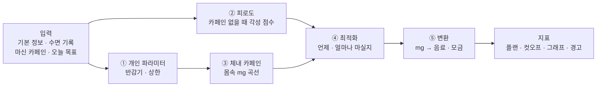

# ☕ 카페인 측정기 (Caffeine Project)

> 내 몸 상태와 오늘 일정을 넣으면 **언제 · 무엇을 · 얼마나** 마시고 **언제부터 끊을지** 알려주는 개인 맞춤 카페인 스케줄러

깨어 있어야 할 때는 졸리고, 자야 할 때는 카페인 때문에 잠이 안 오는 문제를 풉니다.
감으로 마시는 대신, **수면 과학·약동학 논문의 숫자**로 계산합니다.


*엔진 추천 플랜 예시: 최근 6~7시간 수면, 14~17시 시험, 23:00 취침 → "13:45에 100mg, 21:30부터 금지".
위는 각성 점수(점선 = 카페인 없을 때), 아래는 몸속 카페인.*

---

## 어떻게 계산하나



| 단계 | 하는 일 | 근거 논문 | 상태 |
| --- | --- | --- | --- |
| ① 개인 파라미터 | 반감기(기본 5h), 하루·1회 상한, 흡연·피임약·임신 보정, 간질환·약물이면 상담 안내 | 식약처, EFSA 2015, Nehlig 2018 | ✅ `profile.py` |
| ② 피로도 | 수면 압력 + 생체 리듬 + 오후 처짐 + 기상 직후 멍함 → 각성 점수(14 또렷 · 7 위험선) | Åkerstedt 2004, Van Dongen 2003 | ✅ `fatigue.py` |
| ③ 체내 카페인 | 1구획 흡수·분해 모델, 여러 잔은 합산 | Gardiner 2023, Ramakrishnan 2016 | ✅ `pk.py` |
| 카페인 효과 | 졸림 × g (100mg → 졸림 약 19%↓, 3~4시간 지속) | Ramakrishnan 2016 (2B-Alert) | ✅ `effect.py` |
| ④ 최적화 | 졸림은 최대한 줄이고, 위험선 7 지키기 · 잠든 뒤 잔량 ≤ 30mg · 수면 감소 < 20분 · 상한 · 2시간 간격 | Vital-Lopez 2018, Gardiner 2023 | ✅ `optimizer.py` |
| ⑤ 변환 | 커피 0.43mg/ml 등 → 모금 수 (반대로 'n모금 마심' → mg) | Gardiner 2023 인용값 | ✅ `convert.py` |
| 지표 | 상한 대비 %, 위험선 위 시간 비율, 수면 부채, 일·주·월 리포트 | 식약처, NSF(7~9h) | ✅ `metrics.py` |

**핵심 숫자**
- 하루 상한 성인 400mg · 임산부 300mg · 청소년 2.5mg/kg (식약처), 1회 200mg (EFSA)
- 취침 때 몸속 카페인 **30mg 이하** — Gardiner 2023 컷오프(커피 107mg은 취침 8.8시간 전까지)를 역산
- 예상 수면 감소(분) = 21.02 − 0.05 × (취침 전 분) + 0.16 × (mg) — Gardiner 2023 메타회귀

모든 숫자는 [`parameters.yaml`](parameters.yaml)에 **출처**와 **확정/임시** 상태와 함께 있습니다. 코드에는 숫자를 직접 쓰지 않습니다.

## 결과 카드 예시

```text
☕ 오늘의 카페인 플랜

  13:45  커피 13모금 (228ml · 약 97mg)
  13:45 이후엔 플랜 외 카페인 금지
  ⛔ 21:30부터는 한 모금도 금지 (수면 보호)

오늘 총 100mg / 상한 400mg (25%)
잠든 뒤 몸속 카페인 최대 29.2mg (기준 30) · 예상 수면 감소 9.3분 (기준 20)
목표 구간 졸림 7% 감소
최근 1주 수면 부채 4.5시간
```

```python
from caffeine_engine.pipeline import run_day, format_card
from caffeine_engine.profile import Profile
result = run_day(Profile(age=24, weight_kg=70), sleeps, windows, bed_h=23.0, now_h=8.0)
print(format_card(result))
```

## 지금까지 알게 된 것

- 카페인의 **각성 효과는 3~4시간이면 사라지지만, 몸속 카페인은 반감기 5시간**으로 남는다 → 늦게 마신 커피는 수면만 방해하는 구간이 생긴다
- 카페인은 수면 부족으로 생긴 졸림을 **20~30% 정도만** 줄인다 → 수면을 대신할 수 없다
- 반감기 5시간이면 **하루 200mg만 돼도** 새벽 1시 취침을 지키기 빠듯하다
- 피로도 모델은 1주 이상 이어지는 수면 부족을 과소평가한다 (Van Dongen 2003과 비교) → 테스트로 기록
- 시험이 있으면 엔진은 **약 1시간 전**에 마시라고 한다 (효과 최고점이 마신 뒤 약 1시간)
- 23시 취침이면 하루 카페인 여유는 **약 100mg**뿐이다 — 수면 기준(잠든 뒤 30mg)이 가장 강한 제약
- 01시까지 깨어 있어야 하는데 밤에 졸리면, 카페인으로는 못 메운다 → 엔진이 '수면·휴식 필요'로 경고

## 폴더

| 경로 | 내용 |
| --- | --- |
| `parameters.yaml` | 엔진의 모든 숫자 + 출처 + 확정/임시 상태 |
| `caffeine_engine/` | 계산 엔진 — `profile.py` ① · `fatigue.py` ② · `pk.py` ③ · `effect.py` 카페인 효과 · `optimizer.py` ④ · `convert.py` ⑤ · `metrics.py` 지표 · `pipeline.py` 전체 실행 + 결과 카드 |
| `tests/` | 논문 결과 재현 + 규칙 준수 검사 (61개) |
| `scripts/` | 확인용 그래프 스크립트 (`daychart.py` 공통 그리기) |
| `figures/` | 그래프 결과물 |
| `papers/` | 논문 목록 (PDF는 저작권 때문에 로컬 전용) |

## 실행

```bash
python3 -m venv .venv && .venv/bin/pip install -r requirements.txt   # 처음 한 번

.venv/bin/python -m pytest -q                      # 테스트
.venv/bin/python scripts/plot_body_caffeine.py     # 체내 카페인 그래프
.venv/bin/python scripts/plot_day_overview.py      # 각성 점수 + 체내 카페인 그래프
.venv/bin/python scripts/plot_plan.py              # 엔진 추천 플랜 그래프
```

## 진행 상황

- [x] Step 0 — 논문 수집 (13건, 원문 확인)
- [x] Step 1-1 — 체내 카페인
- [x] Step 1-2 — 피로도
- [x] Step 1-3 — 카페인 효과
- [x] Step 1-4 — 최적화 (섭취 플랜 · 컷오프)
- [x] Step 1-5 — 개인 파라미터 · 모금 변환 · 지표 · 전체 실행기
- [ ] Step 1-6 — 데모
- [ ] Step 2~ — 입력 화면, 알림, 리포트, 음료 DB, 피드백 개인화

## 주의

이 프로젝트는 **의학적 조언이 아닙니다.** 평균적인 건강한 성인 기준의 예측이라 개인차가 큽니다.
임신 중이거나 간질환·심장질환이 있거나 카페인 분해를 늦추는 약을 먹는 경우에는 계산 대신 의사와 상담하세요.
