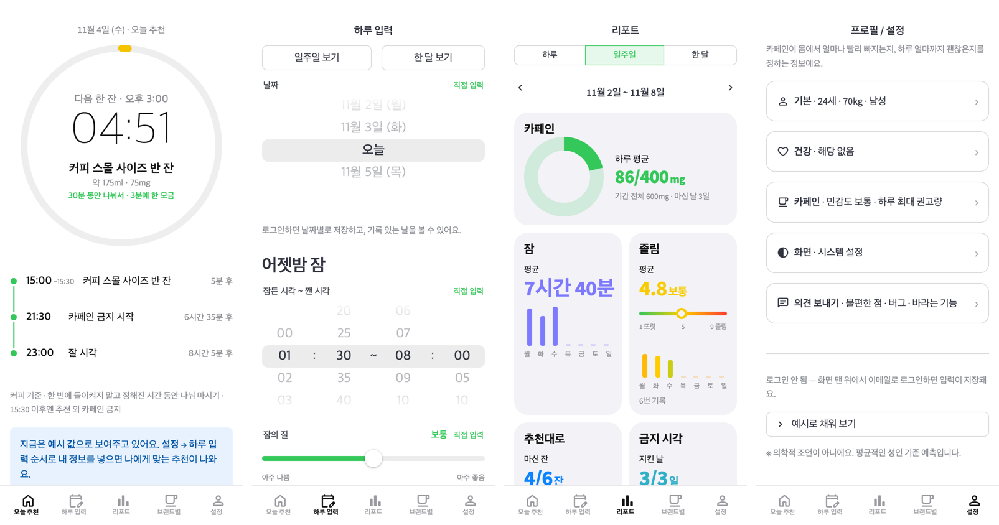
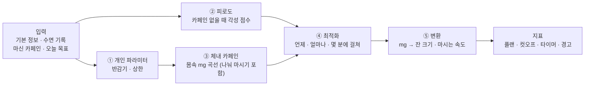

# 카페인 측정기 (Caffeine Project)

> 내 몸 상태와 오늘 일정을 넣으면 **언제 · 무엇을 · 얼마나 · 몇 분에 걸쳐** 마시고 **언제부터 끊을지** 알려주는 개인 맞춤 카페인 스케줄러

**▶ 웹에서 바로 써보기: https://kjyilj0707.github.io/caffeine_project/** (처음 열 때 10~20초 로딩 · 아이폰·안드로이드·PC 브라우저)

깨어 있어야 할 때는 졸리고, 자야 할 때는 카페인 때문에 잠이 안 오는 문제를 풉니다.
감으로 마시는 대신, **수면 과학·약동학 논문의 숫자**로 계산합니다.



*휴대폰 화면 기준 (예시 값). 왼쪽부터 오늘 추천(다음 일정까지 타이머) · 하루 입력(iOS 휠) · 리포트(카드) · 설정.*

---

## 앱 화면 (2026-11-04 개편)

아래 탭 5개: **오늘 추천 · 하루 입력 · 리포트 · 브랜드별 · 설정**

| 화면 | 하는 일 |
| --- | --- |
| 오늘 추천 | 가운데 큰 링 타이머 = 다음 일정(다음 잔 → 카페인 금지 → 잘 시각)까지 남은 시간. 평소 초록 → **10분 전 노랑 → 1분 전 빨강**. 마시는 시간에는 "마시는 중 · 지금쯤 40% 마셨으면 좋아요". 아래에 점·선 시간표 |
| 하루 입력 | 날짜 · 잠든~깬 시각 · 마신 양 · 잘 시각 · 졸면 안 되는/집중 시간을 **iOS 휠**로, 잠의 질은 **끌어서 정하는 선**으로. 모든 휠에 **직접 입력** ("1:37", "01:30-08:00", "11/3", "250") |
| 리포트 | 하루·일주일·한 달. 카페인 링(상한 대비) · 잠 · 졸림(초록→노랑→빨강 색 막대) · 추천대로 마신 잔 · 금지 시각 지킨 날 · 날짜별 마신 양 · **피드백**(지금 졸림 남기기 → 모델 예측과 비교) |
| 브랜드별 | 메뉴 129종 카페인 찾아보기 (분류·브랜드·검색·정렬) + 브랜드별 컵 크기(스몰·기본·빅) |
| 설정 | 기본(나이·몸무게 휠) · 건강 · 카페인(민감도·하루 최대량 휠) · 화면(시스템/라이트/다크) · **의견 보내기**(로그인 없이). 고친 값은 [설정 반영하기]로 반영 |

- **아침 첫 화면**: 사용자의 **잘 시각**이 지나면 다음 날 아침으로 넘어가고, 그날 잠 기록이 없으면 하루 입력부터 연다
- **로그인**: 위쪽 바의 [로그인 · 가입] → 이메일 + 비밀번호. 가입 확인·비밀번호를 잊었을 때는 **메일로 온 숫자 코드**만 쓴다. 한 번 로그인하면 그 기기에서 유지
- **알림**: 위쪽 바 [알림 켜기] → 마실 시각·금지 시각에 휴대폰 알림 (아이폰은 사파리 공유 → 홈 화면에 추가 후)

## 어떻게 계산하나



| 단계 | 하는 일 | 근거 논문 | 상태 |
| --- | --- | --- | --- |
| ① 개인 파라미터 | 반감기(기본 5h), 하루·1회 상한, 흡연·피임약·임신 보정, 간질환·약물이면 상담 안내 | 식약처, EFSA 2015, Nehlig 2018 | ✅ `profile.py` |
| ② 피로도 | 수면 압력 + 생체 리듬 + 오후 처짐 + 기상 직후 멍함 → 각성 점수(14 또렷 · 7 위험선) | Åkerstedt 2004, Van Dongen 2003 | ✅ `fatigue.py` |
| ③ 체내 카페인 | 1구획 흡수·분해 모델, 여러 잔은 합산. **나눠 마시기** = 마시는 시간 동안 10분마다 같은 양 | Gardiner 2023, Ramakrishnan 2016 | ✅ `pk.py` |
| 카페인 효과 | 졸림 × g (100mg → 졸림 약 19%↓, 3~4시간 지속) | Ramakrishnan 2016 (2B-Alert) | ✅ `effect.py` |
| ④ 최적화 | 졸림은 최대한 줄이고, 위험선 7 지키기 · 잠든 뒤 잔량 ≤ 30mg · 수면 감소 < 20분 · 상한 · 2시간 간격. 잔마다 **마시는 시간**(15분·30분·1시간·2시간)도 고름 | Vital-Lopez 2018, Gardiner 2023, Wyatt 2004(방향) | ✅ `optimizer.py` |
| ⑤ 변환 | mg → ml → **잔 크기**(그 양이 들어가는 가장 작은 컵의 몇 분의 몇) + **"2~3분에 한 모금"** 속도 | Gardiner 2023 인용 농도, 브랜드 컵 조사 | ✅ `convert.py` |
| 지표 | 상한 대비 %, 위험선 위 시간 비율, 수면 부채, 일·주·월 리포트 | 식약처, NSF(7~9h) | ✅ `metrics.py` |
| 예측 vs 실제 | 각성 점수 → 예측 졸림(KSS)으로 바꿔 내가 남긴 졸림과 비교 · 잠들 때 몸속 카페인별 잠들기 시간 | Ingre 2014 (KSS = 10.6 − 0.6 × 각성 점수) | ✅ `calibration.py` (보여주기만) |

**핵심 숫자**
- 하루 상한 성인 400mg · 임산부 300mg · 청소년 2.5mg/kg (식약처), 1회 200mg (EFSA)
- 취침 때 몸속 카페인 **30mg 이하** — Gardiner 2023 컷오프(커피 107mg은 취침 8.8시간 전까지)를 역산
- 예상 수면 감소(분) = 21.02 − 0.05 × (다 마신 시각부터 취침까지 분) + 0.16 × (mg) — Gardiner 2023 메타회귀
- 예측 졸림 KSS = 10.6 − 0.6 × 각성 점수 — Ingre 2014 식 1.9
- 브랜드를 모를 때 컵: 스몰 355 · 기본 520 · 빅 670ml (9개 브랜드 조사의 가운데 값)

모든 숫자는 [`parameters.yaml`](parameters.yaml)에 **출처**와 **확정/임시** 상태와 함께 있습니다. 코드에는 숫자를 직접 쓰지 않습니다.

## 결과 카드 예시

```text
오늘의 카페인 플랜

  13:45~14:15  커피 스몰 사이즈 2/3잔 (약 228ml · 97mg) · 30분 동안 나눠서, 2~3분에 한 모금
  14:15 이후엔 플랜 외 카페인 금지
  21:30부터는 한 모금도 금지 (수면 보호)

오늘 총 100mg / 상한 400mg (25%)
잠든 뒤 몸속 카페인 최대 29.9mg (기준 30) · 예상 수면 감소 10.8분 (기준 20)
목표 구간 졸림 7% 감소
최근 1주 수면 부채 4.5시간
```

```python
from caffeine_engine.pipeline import run_day, format_card
from caffeine_engine.profile import Profile
result = run_day(Profile(age=24, weight_kg=70), sleeps, windows, bed_h=23.0, now_h=8.0)
print(format_card(result))
```

## 데이터

| 파일 | 내용 |
| --- | --- |
| [`beverages.yaml`](beverages.yaml) `drinks` | **음료 카페인 DB 129종** — 카페 9개 브랜드·편의점 커피·에너지음료·차 (출처·용량·mg, 조사일 2026-11-01) |
| [`beverages.yaml`](beverages.yaml) `cup_sizes` | **브랜드별 컵 크기** 스몰·기본·빅 (조사일 2026-11-04, 확인 수준: 공식·뉴스·2차) |
| [`parameters.yaml`](parameters.yaml) | 엔진의 모든 숫자 + 출처 + 확정/임시 |
| [`scenarios/`](scenarios) | 데모 입력 4개 |
| [`supabase/migrations/`](supabase/migrations) | 서버 표 정의 (프로필·수면·마신 것·플랜·피드백·알림·의견) + "내 데이터는 나만"(RLS) |
| [`papers/README.md`](papers/README.md) | 논문 목록과 받는 곳 (PDF는 저작권 때문에 저장소에 올리지 않음) |

브랜드별 컵 크기 (ICE 기준 ml, 기본 = 따로 말하지 않으면 받는 크기)

| 브랜드 | 스몰 | 기본 | 빅 | 확인 |
| --- | --- | --- | --- | --- |
| 스타벅스 | Short 237 | Tall 355 | Venti 591 | 2차 |
| 투썸플레이스 | — | Regular 355 | Max 591 | 2차 |
| 할리스 | — | Regular 354 | Venti 591 | 공식 |
| 커피빈 | — | Small 355 | Large 591 | 뉴스 |
| 메가MGC커피 | — | 710 (HOT 591) | 946 | 공식 |
| 컴포즈커피 | — | 591 | 빅포즈 946 | 2차 |
| 빽다방 | — | 660 (HOT 510) | 빽사이즈 990 | 공식 |
| 이디야커피 | — | L 520 | EX 670 | 공식 |
| 더벤티 | — | 600 | 960 | 공식 |
| 그 외 (브랜드 모름) | 355 | 520 | 670 | 위 값의 가운데 |

## 지금까지 알게 된 것

- 카페인의 **각성 효과는 3~4시간이면 사라지지만, 몸속 카페인은 반감기 5시간**으로 남는다 → 늦게 마신 커피는 수면만 방해하는 구간이 생긴다
- 카페인은 수면 부족으로 생긴 졸림을 **20~30% 정도만** 줄인다 → 수면을 대신할 수 없다
- 반감기 5시간이면 **하루 200mg만 돼도** 새벽 1시 취침을 지키기 빠듯하다
- 피로도 모델은 1주 이상 이어지는 수면 부족을 과소평가한다 (Van Dongen 2003과 비교) → 테스트로 기록
- 시험이 있으면 엔진은 **약 1시간 전**에 마시라고 한다 (효과 최고점이 마신 뒤 약 1시간)
- 23시 취침이면 하루 카페인 여유는 **약 100mg**뿐이다 — 수면 기준(잠든 뒤 30mg)이 가장 강한 제약
- 01시까지 깨어 있어야 하는데 밤에 졸리면, 카페인으로는 못 메운다 → 엔진이 '수면·휴식 필요'로 경고
- 사람은 모금을 세며 마시지 않는다 → 추천은 **잔 크기 + 마시는 시간 + "몇 분에 한 모금"**으로 (2026-11-04)
- 30분 동안 나눠 마시면 초반 몸속 최고치는 낮아지지만, 10시간 뒤 잔량은 한 번에 마실 때와 거의 같다 → 수면 기준은 '다 마신 시각'으로 판단
- 지금 예시 4개에서는 엔진이 고르는 속도가 모두 기본 30분 — 다른 속도가 벌점을 1% 넘게 줄이지 못함 (실제 기록으로 조정 예정)
- 저가 브랜드는 **기본 사이즈부터 600~700ml**, 스몰이 따로 있는 곳은 사실상 스타벅스(Short 237ml)뿐

## 폴더

| 경로 | 내용 |
| --- | --- |
| `caffeine_engine/` | 계산 엔진 — `profile.py` ① · `fatigue.py` ② · `pk.py` ③(나눠 마시기 포함) · `effect.py` 카페인 효과 · `optimizer.py` ④ · `convert.py` ⑤ + 컵 크기 · `metrics.py` 지표 · `pipeline.py` 전체 실행 + 결과 카드 · `scenario.py` 시나리오 읽기 · `notify.py` 플랜 → 알림 · `calibration.py` 예측 vs 실제 |
| `app/` | **화면** (Streamlit) — `streamlit_app.py` 시작 · `tabbar.py` 아래 탭 바 · `page_plan.py` 오늘 추천 · `timer_view.py` 타이머 · `page_day.py` 하루 입력 · `dial.py` + `components/dial/` iOS 휠·끄는 선·직접 입력 · `page_report.py` 리포트 · `report_cards.py` 카드 · `report.py` 리포트 계산 · `page_feedback.py` 졸림 피드백 · `page_drinks.py` 브랜드별 카페인 · `page_profile.py` 설정 · `theme.py` 화면 모드·강조색 · `state.py` 공유 입력 · `store.py` 서버 저장 · `account.py` 로그인·서버 요청 · `forms.py` 입력 변환 · `calendar_view.py` 달력 · `charts.py` 그래프 · `ntfy.py` ntfy 알림 |
| `index.html` | GitHub Pages용 — stlite로 브라우저 안에서 Python을 돌려 `app/`을 서버 없이 실행 + 로그인 바·로그인 창(supabase-js) + 웹 푸시 등록 |
| `404.html` | 앱 안 탭 주소(…/page_report)를 새로고침하면 앱 첫 화면으로 |
| `sw.js` · `manifest.webmanifest` · `icons/` | 웹 푸시 수신 · 홈 화면에 추가했을 때 앱 아이콘 |
| `supabase/` | 서버 표·권한 `migrations/` (0001 기본 · 0002 웹 푸시 · 0003 의견 보내기) · 알림 발송 함수 `functions/send-push` |
| `tests/` | 논문 결과 재현 + 규칙 준수 + 화면 + 알림 + 음료 DB + 기록·리포트·개인화 + 나눠 마시기·컵 크기·직접 입력 검사 (148개) |
| `scenarios/` | **데모 입력 파일** — 고쳐서 다시 실행하면 결과가 바뀜 |
| `scripts/` | `demo.py` 데모 · 그래프 스크립트 · `phone_preview.html` 휴대폰 틀 미리보기 · `phone_shot.py` 휴대폰 크기 캡처 |
| `figures/` | 그래프 · 화면 캡처(`ui_*.png`) |
| `papers/` | 논문 목록 (PDF는 로컬 전용) |
| `.streamlit/config.toml` | 로컬 실행 설정 (테마는 넣지 않음 — 넣으면 사용자가 고른 다크/라이트가 무시됨) |

## 실행

```bash
python3 -m venv .venv && .venv/bin/pip install -r requirements.txt   # 처음 한 번

.venv/bin/streamlit run app/streamlit_app.py             # 앱 (브라우저가 열림, 로그인 없이 예시 값)
.venv/bin/python scripts/demo.py                          # 데모: scenarios/ 시나리오 전부
.venv/bin/python scripts/demo.py scenarios/exam_day.yaml  # 시나리오 하나만
.venv/bin/python -m pytest -q                             # 테스트
```

**휴대폰 화면으로 보며 고치기**: 앱을 `--server.runOnSave true`로 띄운 뒤 `open scripts/phone_preview.html` → 휴대폰 틀 안에 앱이 뜨고 코드를 저장하면 바로 바뀜.
캡처는 `python scripts/phone_shot.py <폴더> page_report` (playwright 필요).

**배포**: `main` 브랜치에 올리면 GitHub Pages가 1~3분 안에 웹앱을 바꾼다. 새 `app/` 파일은 `index.html`의 파일 목록에도 넣어야 한다 (테스트가 검사).

### 데모 시나리오 바꾸기

`scenarios/exam_day.yaml`을 열어 숫자·시각을 고치고 다시 실행하면 결과 카드와 `figures/demo_*.png` 그래프가 바뀝니다.

```yaml
profile: {age: 24, weight_kg: 70, smoker: false, sensitivity: normal}
sleep:                  # 오래된 밤부터, 마지막 줄 = 어젯밤 ("잠든-깬")
  - "00:30-07:30"
  - "01:30-08:00"
today:
  now: "08:00"
  bed: "23:00"          # 기상 시각보다 이르면 다음 날 새벽
  already: []           # 예: - {time: "09:00", mg: 100} · {time: "09:00", sips: 8} · {time: "09:00", cups: 1, size: 기본}
  windows:              # 깨어 있기 / 졸면 안 됨 / 집중
    - {kind: 졸면 안 됨, from: "14:00", to: "17:00"}
beverage: coffee        # coffee / black_tea / {name: "아메리카노 톨", mg: 150, ml: 355}
```

| 예시 시나리오 | 엔진의 답 |
| --- | --- |
| `exam_day` 시험 날, 23시 취침 | 13:45~14:15 커피 스몰 2/3잔(228ml) 30분 동안, 21:30부터 금지 |
| `late_night` 과제 마감, 01시 취침, 오전에 이미 한 잔 | 18:00~18:30 아메리카노 톨 1/3잔만 + "밤 1시간은 카페인으로 못 메움" 경고 |
| `smoker_early_shift` 흡연자, 05:30 기상 운전 출근 | 05:45 기본 1잔 · 11:45 기본 3/4잔 (분해가 빨라 약 375mg) |
| `pregnant_sensitive` 임신 후기, 카페인 민감 | 카페인 없이 (반감기 약 15시간이라 수면 기준을 지킬 수 없음) |

## 진행 상황

- [x] Step 0 — 논문 수집 (13건, 원문 확인)
- [x] Step 1-1 — 체내 카페인
- [x] Step 1-2 — 피로도
- [x] Step 1-3 — 카페인 효과
- [x] Step 1-4 — 최적화 (섭취 플랜 · 컷오프)
- [x] Step 1-5 — 개인 파라미터 · 모금 변환 · 지표 · 전체 실행기
- [x] Step 1-6 — 데모 (시나리오 파일 → 결과 카드 + 그래프)
- [x] Step 2 — 입력 화면 MVP (Streamlit, GitHub Pages 배포)
- [x] Step 3 — 알림 (마셔 / 금지 / 상한 경고) — ntfy 예약 푸시, 핸드폰 수신 확인
- [x] 음료 카페인 DB 조사 (129종, `beverages.yaml`) — 브랜드→메뉴→사이즈 고르기로 앱에 연결 (4-④)
- [x] Step 4 — 로그인·기록 저장 (Supabase) · 화면 개편 · 달력 · 앱 웹 푸시 알림 · 매일 피드백(졸림 KSS·잠들기) · 리포트(하루·일주일·한 달)
- [x] Step 5-① — 예측 vs 실제: '모델 예측 졸림 vs 내 졸림', '잠들 때 카페인 vs 잠들기 시간' (추천은 아직 그대로)
- [x] UI 개편 (2026-11-04) — 휴대폰 화면 기준: 아래 탭 바 · 이모지 제거 · 타이머형 추천 · 카드형 리포트 · iOS 휠 입력 + 직접 입력 · 다크/라이트 · 설정 목록형 + 설정 반영하기 · 아침 첫 화면 = 하루 입력 · 피드백 화면 · 로그인 전 예시 리포트
- [x] 나눠 마시기 추천 (2026-11-04) — '몇 모금' 대신 '잔 크기 · 마시는 시간 · 몇 분에 한 모금'
- [x] 브랜드별 컵 크기 9개 브랜드 + '그 외' (2026-11-04)
- [x] 간편 로그인 (2026-11-04) — 이메일 + 비밀번호, 가입 확인·비밀번호 분실은 숫자 코드만, 로그인 유지 · 이메일 기억 · 비밀번호 자동 채우기
- [x] 설정 → 의견 보내기 (2026-11-04) — 로그인 없이, `app_feedback` 표 (쓰기만 가능)
- [ ] 받은 의견 정리 · 음료 DB mg 보강 조사
- [ ] Step 5-② — 개인 보정: 쌓인 차이로 이 사람의 위험선·취침 허용 잔량 등을 조정해 추천에 반영 (기록 1~2주 후)

### 2026-11-04 개편에서 부딪힌 문제와 해결

| 문제 | 원인 | 해결 |
| --- | --- | --- |
| 리포트 링·막대그래프가 안 보임 | `st.html`이 SVG를 지움 | CSS 도형(conic-gradient·div 막대)으로 그림 |
| 다크/라이트를 골라도 무시됨 | 설정 파일에 테마(강조색)가 있으면 Streamlit이 저장된 선택을 덮어씀 | 설정에서 테마를 빼고 강조색 초록은 CSS(`app/theme.py`)로 |
| 화면 모드가 탭마다 따로 | Streamlit이 테마를 페이지 주소마다 따로 저장 | 고를 때 모든 페이지 주소에 같은 값을 씀 |
| 휠·끄는 선 입력이 Streamlit에 없음 | — | 사용자 부품 v1을 빌드 없이 HTML 파일 하나로 (`app/components/dial/`), stlite에서도 동작 확인 |
| 웹판 로그아웃 후 404 | 탭을 옮기면 주소가 …/page_report로 바뀌는데 GitHub Pages엔 그 파일이 없음 | 다시 불러올 때 처음 연 주소로 + `404.html` |
| [메일 코드로]가 안 눌리는 것처럼 보임 | 새 이메일은 코드로 가입 못 하게 막혀 있었음 | 코드로도 가입 가능하게, 로그인·가입 창을 따로 |
| 아이폰 다크 모드에서 버튼 글자 안 보임 | 흰 버튼에 기본 글자색(흰색) | 버튼·입력칸 색을 직접 지정 |
| 테스트 도구가 멈춤 | Streamlit 1.50 AppTest: 한 개만 고르는 세그먼트 버튼이 있는 화면에서 다른 칸을 바꾸면 값이 깨짐 | 해당 테스트를 나눔, 설정의 화면 모드는 라디오 버튼으로 |

## 알림 쓰는 법

**앱 알림 (로그인 필요, 추천)**: 위쪽 바 [알림 켜기] → 허용. 오늘 추천 화면 아래 「알림」에서 오늘 알림 예약.
아이폰은 사파리 공유 → **홈 화면에 추가** 후 그 앱에서 켜야 한다 (iOS 16.4 이상). 안드로이드 크롬은 바로 된다.

**ntfy (로그인 없이)**: 오늘 추천 → 「핸드폰 알림 받기 (ntfy 앱)」

1. 핸드폰에 [ntfy](https://ntfy.sh) 앱 설치 → 알림 허용 → **＋** → 채널 이름 구독 (영문·숫자·-·_, 남이 못 맞힐 만큼 길게)
2. 앱 화면에 같은 채널 이름 입력 → **채널 끝 4자리**가 ntfy 앱과 같은지 확인
3. 「1분 뒤 테스트 알림」으로 확인 → 「오늘 알림 예약」
- 예약은 ntfy 서버가 보내므로 **브라우저를 닫아도** 알림이 온다 (최대 3일 뒤까지)
- 한계: 플랜을 바꿔 다시 예약해도 이전 예약은 취소되지 않음 / 채널 이름을 아는 사람은 알림을 볼 수 있음

## 주의

이 프로젝트는 **의학적 조언이 아닙니다.** 평균적인 건강한 성인 기준의 예측이라 개인차가 큽니다.
임신 중이거나 간질환·심장질환이 있거나 카페인 분해를 늦추는 약을 먹는 경우에는 계산 대신 의사와 상담하세요.
